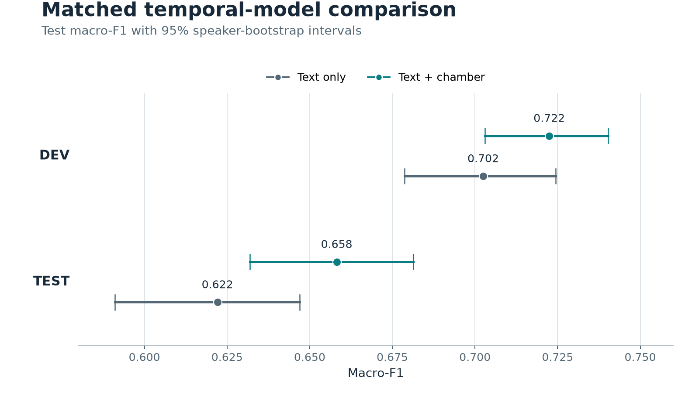

# Predicting Partisanship in Congress

This project studies whether the documented party affiliation of a member of the U.S. Congress can be predicted from their floor speeches. It uses congressional speech data and evaluates text-only models alongside models that also use chamber or year metadata.

> **Course project:** APAI4011 · Group project
>
> **Study corpus:** 20,000 speeches from the 110th–114th Congresses

## Get started

From the repository root, use Python 3.11 or newer:

```powershell
python -B scripts/verify_week1.py
python -B scripts/verify_week2_formal.py --require all
```

The first command restores the frozen corpus from its five compressed files, if needed, and verifies the Week 1 inputs and baseline results. The second verifies the completed Week 2 runs and their predictions. Both checks run offline and do not require model checkpoints.

To reproduce the Week 3 analysis after verification:

```powershell
python -B scripts/week3_analysis.py
python -B scripts/verify_week3.py
python -B scripts/week3_plot.py
```

## Latest results

The matched Week 3 comparison evaluates the seed-4011 text-only and text-plus-chamber models on the same chronological-split speeches. Scores are **macro-F1 / accuracy**:

| Partition | Text only | Text + chamber |
| --- | ---: | ---: |
| Development | 0.702 / 0.710 | 0.722 / 0.723 |
| Test | 0.622 / 0.632 | 0.658 / 0.659 |



See the [Week 3 comparison report](reports/week3_comparison.md) for confidence intervals, matched error groups, representative cases, lexical cues, and the frozen text-edit analysis. Machine-readable predictions and analysis outputs are in [`results/week3/error_analysis/`](results/week3/error_analysis/).

## Project workflow

| Stage | What it covers | Guide and outputs |
| --- | --- | --- |
| **Week 1 · Data and baselines** | Build and audit the frozen speech corpus, dated party labels, evaluation splits, and CPU baselines. | [Week 1 handoff](reports/week1_handoff.md) · [`data/week1/`](data/week1/) · [`results/week1/`](results/week1/) |
| **Week 2 · Model experiments** | Train and compare RoBERTa models using text and optional year/chamber features under speaker-disjoint and chronological protocols. | [Week 2 handoff](reports/week2_handoff.md) · [comparison report](reports/week2_comparison.md) · [`results/week2/`](results/week2/) |
| **Week 3 · Robustness and errors** | Compare matched predictions, inspect error groups and lexical cues, and evaluate fixed edits to speech text. | [Week 3 handoff](reports/week3_handoff.md) · [comparison report](reports/week3_comparison.md) · [`results/week3/`](results/week3/) |

## Data and evaluation

The source is Stanford's [Congressional Record dataset](https://data.stanford.edu/congress_text). The repository includes five compressed speech-corpus files under [`data/week1/by_congress/`](data/week1/by_congress/); `scripts/verify_week1.py` restores `data/week1/corpus.jsonl` and checks it against the frozen manifest.

The study contains 20,000 speeches by 874 legislators. Democratic and Republican speeches are used for the proposed binary classification experiments; speeches with other documented affiliations are retained for descriptive analysis. Two fixed evaluation protocols are provided:

- **Speaker-disjoint:** legislators in the train, development, and test partitions do not overlap.
- **Chronological:** train on earlier Congresses, develop on the 113th Congress, and test on the 114th Congress.

Join the corpus to [`data/week1/splits.csv`](data/week1/splits.csv) using `speech_id`. Use `canonical_speaker_id` to group speeches by legislator. See the [Week 1 handoff](reports/week1_handoff.md) for the cohort, preprocessing, split sizes, and baseline methodology.

## Reproduce model runs

Activate the project's training environment before running these commands from the repository root:

```powershell
# Small text-only pilot
python -B scripts/week2_text_pilot.py

# Full experiment queue
python -u -B scripts/week2_formal.py

# Verify the completed runs and build the comparison report
python -B scripts/verify_week2_formal.py --require all --check-checkpoints
python -B scripts/week2_compare.py
```

The formal queue includes text-only and metadata variants across both evaluation protocols. Run `python -B scripts/week2_formal.py --help` for selection and deadline options. Predictions, metrics, and run settings are published under `results/week2/`; downloaded weights, checkpoints, and training caches are kept outside the shared results.

For Week 3 inference with edited speech, follow the [checkpoint installation and inference guide](reports/week3_weights.md). Use development data to choose edits or analysis rules, then apply those fixed choices to the held-out test data.

## Repository map

```text
data/        Frozen corpus, split manifests, and reference material
scripts/     Data preparation, training, verification, and analysis
reports/     Handoff guides, methods, and comparison reports
results/     Shared metrics, predictions, figures, and analysis outputs
checkpoints/ Local model checkpoints (not shared)
```

The project keeps reproducible outputs in version control while leaving large downloaded model weights, intermediate checkpoints, optimizer states, and experiment caches on the workstation.
