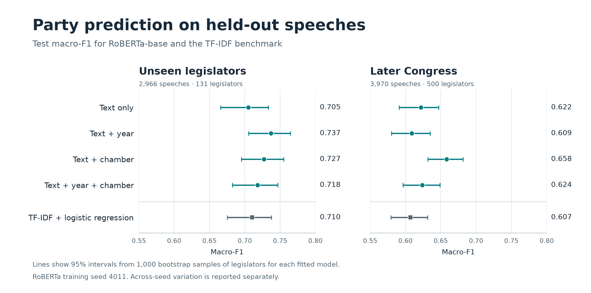

# Week 2 · Party affiliation from congressional speeches

Completed test evaluations cover **8/8 primary settings** (seed 4011) and **8/8 additional runs** for the text and text + year + chamber comparison. Both protocols score the audited Democratic and Republican labels.

Each run trained for 3 epochs. Development macro-F1 selected the checkpoint, with the earliest epoch breaking ties. Test scores use the complete frozen partition for each protocol. For the metadata variants, the model adds a learned year or chamber term to the text logits before averaging window probabilities. Year is standardized using the training speeches and chamber is coded as House 0 or Senate 1.

## Unseen legislators

Each cell gives macro-F1 [95% speaker-bootstrap interval] / accuracy.

| Model | Selected epoch | Development | Test |
|---|---:|---:|---:|
| Training majority | — | 0.346 [0.285, 0.399] / 0.528 | 0.346 [0.285, 0.397] / 0.529 |
| TF-IDF + logistic regression | — | 0.702 [0.652, 0.739] / 0.704 | 0.710 [0.675, 0.738] / 0.713 |
| Year + chamber logistic regression | — | 0.480 [0.417, 0.534] / 0.506 | 0.524 [0.451, 0.597] / 0.548 |
| RoBERTa, text | 3 | 0.691 [0.636, 0.729] / 0.700 | 0.705 [0.666, 0.733] / 0.713 |
| RoBERTa, text + year | 3 | 0.728 [0.687, 0.760] / 0.730 | 0.737 [0.705, 0.765] / 0.738 |
| RoBERTa, text + chamber | 3 | 0.696 [0.646, 0.734] / 0.701 | 0.727 [0.695, 0.755] / 0.730 |
| RoBERTa, text + year + chamber | 3 | 0.714 [0.667, 0.747] / 0.718 | 0.718 [0.682, 0.747] / 0.722 |

RoBERTa, text minus TF-IDF + logistic regression gives **-0.006** test macro-F1 (paired 95% interval [-0.028, +0.022]).

RoBERTa, text + year + chamber minus RoBERTa, text gives **+0.013** test macro-F1 (paired 95% interval [-0.005, +0.030]).

## Later Congress

Each cell gives macro-F1 [95% speaker-bootstrap interval] / accuracy.

| Model | Selected epoch | Development | Test |
|---|---:|---:|---:|
| Training majority | — | 0.338 [0.313, 0.364] / 0.511 | 0.318 [0.289, 0.345] / 0.466 |
| TF-IDF + logistic regression | — | 0.690 [0.668, 0.711] / 0.696 | 0.607 [0.579, 0.631] / 0.615 |
| Year + chamber logistic regression | — | 0.338 [0.313, 0.364] / 0.511 | 0.318 [0.289, 0.345] / 0.466 |
| RoBERTa, text | 3 | 0.702 [0.679, 0.724] / 0.710 | 0.622 [0.591, 0.647] / 0.632 |
| RoBERTa, text + year | 3 | 0.693 [0.673, 0.713] / 0.701 | 0.609 [0.580, 0.635] / 0.618 |
| RoBERTa, text + chamber | 3 | 0.722 [0.703, 0.740] / 0.723 | 0.658 [0.632, 0.681] / 0.659 |
| RoBERTa, text + year + chamber | 3 | 0.699 [0.679, 0.719] / 0.706 | 0.624 [0.597, 0.649] / 0.631 |

RoBERTa, text minus TF-IDF + logistic regression gives **+0.015** test macro-F1 (paired 95% interval [-0.005, +0.036]).

RoBERTa, text + year + chamber minus RoBERTa, text gives **+0.002** test macro-F1 (paired 95% interval [-0.011, +0.015]).

## Legislator history in the chronological test

| Model | Seen in training | Unseen in training |
|---|---:|---:|
| Training majority | 0.325 [0.293, 0.356] / 0.482 | 0.290 [0.240, 0.335] / 0.408 |
| TF-IDF + logistic regression | 0.620 [0.587, 0.652] / 0.629 | 0.561 [0.505, 0.608] / 0.566 |
| Year + chamber logistic regression | 0.325 [0.293, 0.356] / 0.482 | 0.290 [0.240, 0.335] / 0.408 |
| RoBERTa, text | 0.621 [0.588, 0.653] / 0.634 | 0.622 [0.567, 0.670] / 0.626 |
| RoBERTa, text + year | 0.605 [0.572, 0.635] / 0.616 | 0.620 [0.566, 0.668] / 0.622 |
| RoBERTa, text + chamber | 0.647 [0.618, 0.672] / 0.648 | 0.696 [0.647, 0.736] / 0.697 |
| RoBERTa, text + year + chamber | 0.623 [0.592, 0.653] / 0.632 | 0.624 [0.573, 0.670] / 0.626 |

The 114th Congress test contains 3,118 speeches from 353 training-seen legislators and 852 from 147 training-unseen legislators. The full protocols also use different training populations, which limits interpretation of their score gap.

## Training-seed variation

Entries below give test macro-F1 across available seeds for the predefined key comparison. SD is the sample standard deviation across independently fitted models.

| Protocol | Model | Seeds completed | Mean macro-F1 | SD |
|---|---|---|---:|---:|
| speaker | RoBERTa, text + year + chamber | 4011, 4012, 4013 | 0.707 | 0.010 |
| speaker | RoBERTa, text | 4011, 4012, 4013 | 0.700 | 0.011 |
| temporal | RoBERTa, text + year + chamber | 4011, 4012, 4013 | 0.648 | 0.022 |
| temporal | RoBERTa, text | 4011, 4012, 4013 | 0.637 | 0.017 |

In the speaker protocol, adding year and chamber improved macro-F1 in 2 of 3 matched seeds. The mean change was +0.007 (range -0.011 to +0.019).

In the temporal protocol, adding year and chamber improved macro-F1 in 2 of 3 matched seeds. The mean change was +0.011 (range -0.001 to +0.033).

## Reproduction

Each model comparison uses the same frozen speech IDs, labels and canonical speaker IDs. Confidence intervals resample entire legislators 1,000 times (seed 4011) and condition on the fitted models. Paired differences use the same speaker draws for both models. TF-IDF uses the full cleaned speech. RoBERTa averages probabilities across the frozen token windows, which can omit the middle of long speeches.

Run `python -B scripts/week2_compare.py` from the repository root using the Week 1 scikit-learn environment. The machine-readable results contain each run’s preferred epoch, both classes’ precision, recall and F1, confusion matrices, subgroup results, paired differences, and cross-seed summaries. [Detailed results](../results/week2/formal_summary/comparison.json) · [Per-run predictions and settings](../results/week2/formal/)
