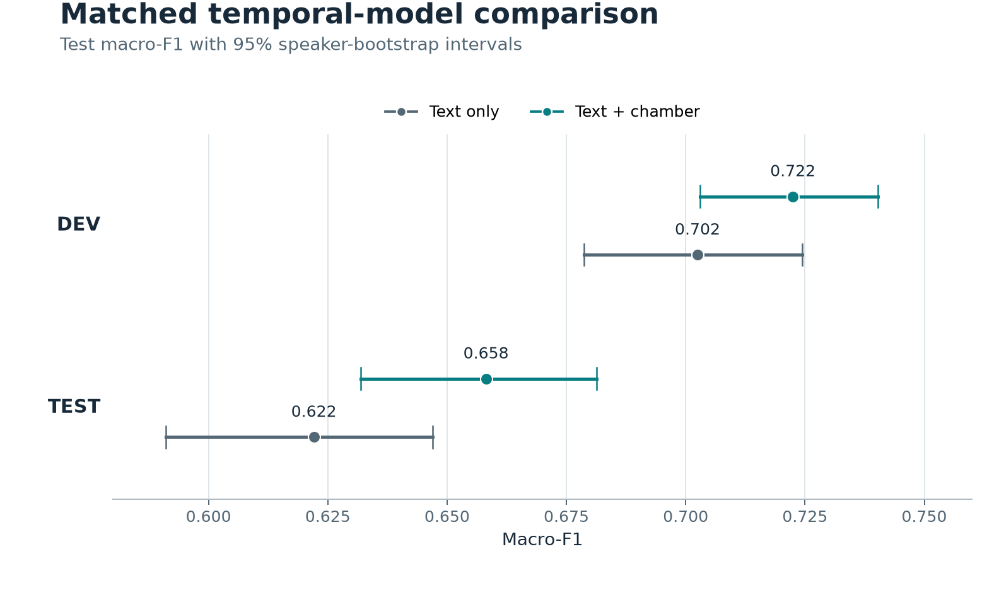

# Week 3 · Robustness and error analysis

**23 November 2026 · U.S. congressional speeches.** This report compares matched text-only and text-plus-chamber predictions on the fixed development and test partitions. Development choices are separated from the held-out test check.

## Matched model comparison

Each cell gives macro-F1 [95% speaker-bootstrap interval] / accuracy.

| Partition | Text only | Text + chamber |
|---|---|---|
| Dev | 0.702 [0.679, 0.724] / 0.710 | 0.722 [0.703, 0.740] / 0.723 |
| Test | 0.622 [0.591, 0.647] / 0.632 | 0.658 [0.632, 0.681] / 0.659 |

## Matched error groups

| Partition | Both correct | Chamber only correct | Text only correct | Both wrong |
|---|---:|---:|---:|---:|
| Dev | 2512 | 357 | 306 | 793 |
| Test | 2196 | 419 | 313 | 1042 |

## Representative cases

The file `representative_cases.csv` contains 80 selected speech IDs with the source text and both model decisions. Selection used development categories first; test rows were included only after the category rules were fixed.

## Lexical cues

`lexical_cues.csv` ranks TF-IDF logistic-regression features separately for the temporal and speaker-disjoint protocols. These cues describe the baseline model and are not a direct explanation of RoBERTa.

## Frozen text edits

The same 3,968 development speeches and 3,970 test speeches were scored again after four frozen edits. No weights were updated. A local Apple GPU run in 32-bit precision matches the saved Week 2 labels on 3,963 of 3,968 development speeches and 3,965 of 3,970 test speeches for the text model. Each cell is macro-F1 / accuracy. Flips count predictions that differ from that model's own original-text prediction.

| Edit | Dev text | Dev chamber | Test text | Test chamber |
|---|---:|---:|---:|---:|
| Original | 0.702 / 0.709 | 0.723 / 0.724 | 0.621 / 0.631 | 0.657 / 0.658 |
| Party-name mask | 0.697 / 0.704 | 0.708 / 0.708 | 0.613 / 0.621 | 0.636 / 0.636 |
| Heading removed | 0.704 / 0.711 | 0.722 / 0.722 | 0.629 / 0.637 | 0.654 / 0.655 |
| First sentence removed | 0.701 / 0.708 | 0.720 / 0.721 | 0.626 / 0.635 | 0.647 / 0.648 |
| Last sentence removed | 0.701 / 0.709 | 0.720 / 0.721 | 0.619 / 0.629 | 0.656 / 0.656 |

Party-name masking is the edit that lowers the score on both partitions. The drop is larger for the chamber model, 0.015 on development and 0.021 on test, and almost all of those flips turn a Democrat prediction into a Republican prediction. Removing the last sentence changes the most labels, 140 on development and 156 on test for the text model, while macro-F1 stays within 0.003 of the original. Heading removal slightly raises the text-only score on both partitions.

Development slices, confident mistakes, and the conclusion for each result are in [Error analysis and improvement run](error_analysis_and_improvement_run.md).

## Scope

Matched error analysis, lexical cues, and the frozen edit check are complete for the temporal text and text-plus-chamber models, seed 4011. The edit rules were fixed on development and then applied once to test.

## Reproduction

Run `python -B scripts/week3_analysis.py` from the repository root using the Week 1 analysis environment.

The machine-readable outputs contain exact matched speech IDs, probabilities, confusion matrices, bootstrap intervals and ranked lexical cues.
[Matched predictions](../results/week3/error_analysis/)
