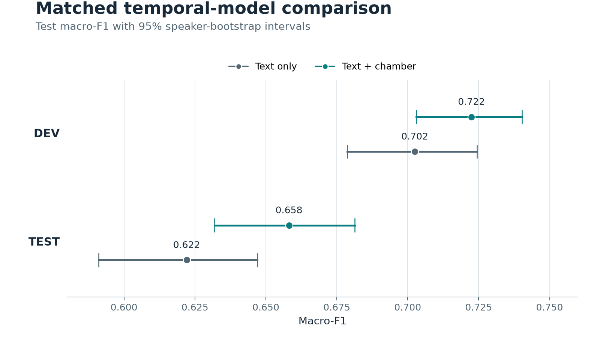
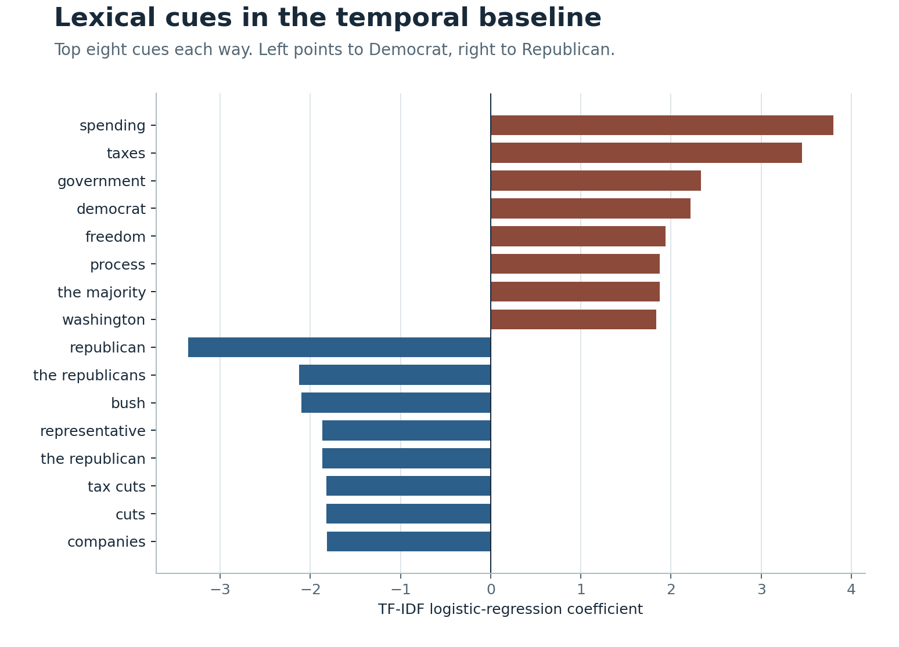
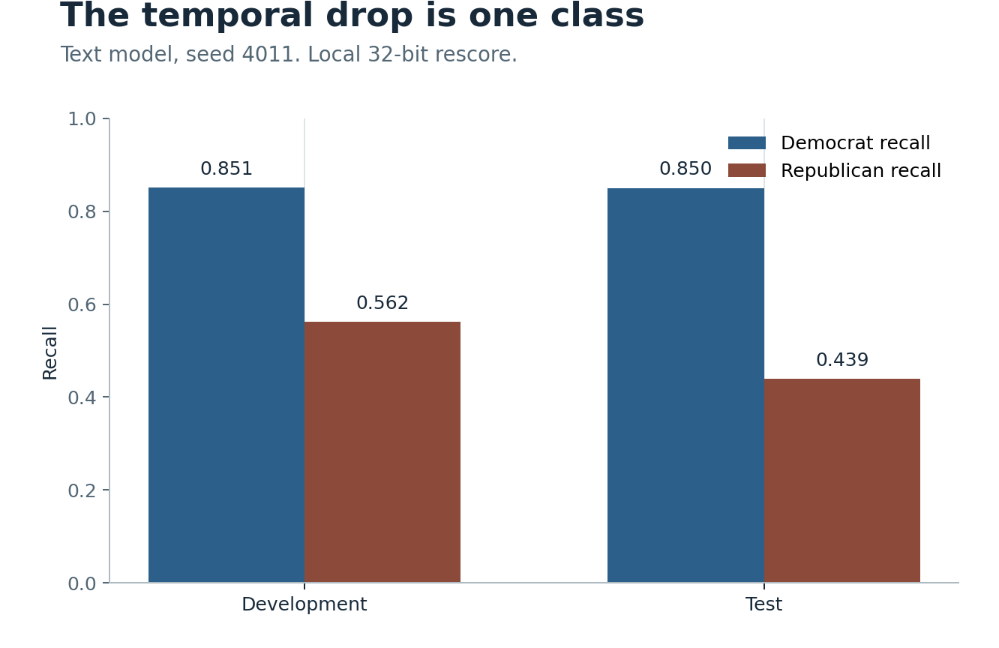
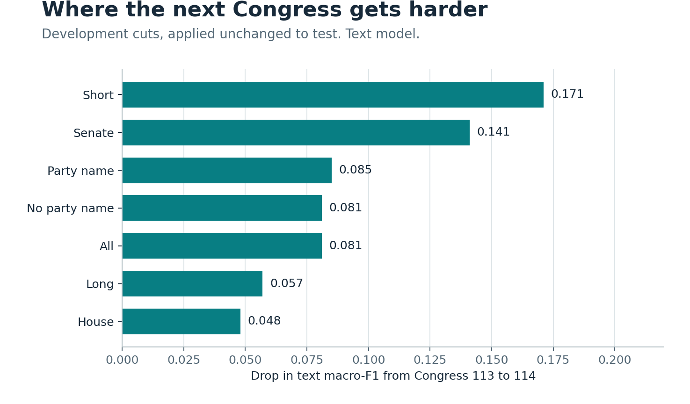

# Predicting party from congressional speeches

Week 3 talk. Temporal RoBERTa, seed 4011. Development is Congress 113. Test is Congress 114. Gold party was not changed, and the models were not retrained.

Read the outline, then present sections 1 through 10 in order. Each section is one slide: one sentence to say, then the points, then the figure or table. The appendix holds the full numbers if someone asks.

## Outline

1. [The question](#1-the-question)
2. [The score we are explaining](#2-the-score-we-are-explaining)
3. [The answer](#3-the-answer)
4. [Lexical cues](#4-lexical-cues)
5. [Procedural cues](#5-procedural-cues)
6. [Framing cues](#6-framing-cues)
7. [The error those cues leave behind](#7-the-error-those-cues-leave-behind)
8. [Where that error sits](#8-where-that-error-sits)
9. [What we ruled out](#9-what-we-ruled-out)
10. [What to close on](#10-what-to-close-on)

Backup: [Appendix tables](#appendix-tables) · [Figures](#figures)

---

## 1. The question

**Say:** We ask which words and habits the model uses, and which of those habits show up again in the mistakes.

RQ3. Which lexical, procedural, or framing cues characterize the predictions and the recurring errors?

- Lexical: party names, issue words, and names tied to one administration.
- Procedural: floor formulas such as "Mr. Speaker" and the weekly schedule.
- Framing: how a speaker refers to the other party, as opposed to the topic itself.
- The primary number around these cues is macro-F1. The classes are Democrat and Republican.

---

## 2. The score we are explaining

**Say:** The model holds up inside one Congress and loses about 0.08 on the next one. The rest of the talk is about what that loss is made of.

| Model | Development macro-F1 | Test macro-F1 |
|---|---:|---:|
| Text | 0.702 | 0.622 |
| Text + chamber | 0.722 | 0.658 |

- Both models were already trained. This week edits the speech and rescores the saved weights.
- Chamber helps on both Congresses. It does not remove the drop.
- Local 32-bit scores, used in the later tables, are 0.702 / 0.621 for text and 0.723 / 0.657 for text plus chamber.

Figure already made: [matched comparison](../results/week3/error_analysis/model_comparison.png).

---

## 3. The answer

**Say:** Predictions follow party names, issue frames, and a little floor language. The recurring error is a Republican speech read as Democratic, and the party-name shortcut is too small to be that error.

- **Party names are a real shortcut.** Hiding them lowers test macro-F1 by about 0.01. Most speeches do not contain one.
- **Issue and era words carry the lexical score.** "Workers" and "middle class" point to Democrat. "Spending" and "taxes" point to Republican. "Bush" points to Democrat and does not travel forward.
- **Floor language is a weak cue.** Removing "Mr. Speaker" does not hurt. A few schedule scripts are extreme mistakes, and they are 23 of 285 sure errors.
- **The recurring error is one class.** Democrat recall stays at 0.85. Republican recall falls from 0.56 to 0.44. Seen and unseen legislators score the same.

---

## 4. Lexical cues

**Say:** The baseline ranks three families of words: the other party's name, the issue frame, and an administration that the next Congress does not share.

The list is the temporal TF-IDF logistic regression. It explains that baseline. It is not a direct readout of RoBERTa. Negative coefficients point to Democrat. Positive coefficients point to Republican.

- **Other party's name.** `republican` is the strongest Democratic cue. `democrat` is the fourth Republican cue. The model treats the named party as the speaker.
- **Issue frame.** Democrat: `tax cuts`, `workers`, `middle class`, `insurance`. Republican: `spending`, `taxes`, `government`, `freedom`, `taxpayer`.
- **Era name.** `bush` and `bush administration` rank toward Democrat in this protocol. On the speaker-disjoint list, the Republican side instead leads with `obamacare`, `obama`, `2015`, and `2016`.
- **Seat, not argument.** `connecticut` leans Democrat. `texas`, `wyoming`, `georgia`, and `tennessee` lean Republican.

Figure: [lexical cues](../results/week3/robustness/lexical_cues.png). Top eight each way.

---

## 5. Procedural cues

**Say:** The opening address is a weak cue. The recurring procedural mistake is a short schedule script, and it is a small share of the sure errors.

- `mr speaker`, `for yielding`, `the majority`, and `process` lean Republican in the baseline. In these Congresses that tracks who holds the House floor.
- Removing a leading "Mr. Speaker" or "Madam Chairman" raises text macro-F1 by 0.002 on development and 0.008 on test.
- Procedural speeches as a group are easier than the rest: development text accuracy 0.778 against 0.703.
- Sure mistakes at confidence 0.90 or higher: 285. Schedule scripts are 23 of them. Gold stays Republican. The prediction is Democrat, near 0.99, often with no party name.

One schedule names the other party's officer and is still read as that party. `hein-daily:1130020385`, predicted Democrat at 0.996:

> First, I thank the gentleman from Maryland, the Democratic whip, for yielding. Mr. Speaker, on Monday, the House will meet at 2 p.m. in pro forma session.

No separate figure. The count 23 of 285 is the visual. If a slide needs a picture, use the two quotes below the heading-removal result in the [edit chart](../results/week3/robustness/edit_macro_f1.png).

---

## 6. Framing cues

**Say:** When a speaker names the other party, the model often takes that name as the speaker's own party. Deleting the word shows the shortcut is real and small.

Same frozen expression on development, then once on test. Text model.

| Edit | Dev macro-F1 | Test macro-F1 | Test D recall | Test R recall |
|---|---:|---:|---:|---:|
| Original | 0.702 | 0.621 | 0.850 | 0.439 |
| Replaced with `[PARTY]` | 0.697 | 0.613 | 0.829 | 0.440 |
| Word deleted | 0.698 | 0.613 | 0.830 | 0.440 |

- The two edits agree within 0.001. The drop is the missing name, not the unfamiliar token `[PARTY]`.
- Deletion flips 60 test predictions. 50 of those flips are Democrat to Republican. 47 correct predictions become wrong, and 13 wrong predictions become correct.
- Republican recall does not move. The shortcut props up Democrat predictions. It does not repair the Republican miss.
- Example, `hein-daily:1130072017`, gold Democrat, 0.939 Democratic until the party word is masked:

> This bill is insulting to women, and the Republicans are asking for it in the next election.

Speeches with a party name score 0.772 on development. Speeches without one still score 0.680. Most speeches have no party name.

Use the existing [edit chart](../results/week3/robustness/edit_macro_f1.png) and [flip chart](../results/week3/robustness/edit_flips.png) here. The flip chart is the one that shows the last sentence moving many labels while the score stays flat. Say that in one clause, then leave it.

---

## 7. The error those cues leave behind

**Say:** Democrat recall does not fall. Republican recall does. Familiar speakers are not the reason.

Text model, local 32-bit rescore.

| Partition | D recall | R recall | Republican called Democrat | Macro-F1 |
|---|---:|---:|---:|---:|
| Development | 0.851 | 0.562 | 850 of 1,939 | 0.702 |
| Test | 0.850 | 0.439 | 1,189 of 2,118 | 0.621 |

- On test, Republicans are 2,118 of 3,970 speeches. The miss is largest in the class that became the majority.
- Text plus chamber raises Republican recall to 0.694 on development and 0.581 on test. The drop is still there.
- Seen legislators, 3,118 speeches: macro-F1 0.620, Republican recall 0.436.
- Unseen legislators, 852 speeches: macro-F1 0.622, Republican recall 0.448.

Figure: [class recall](../results/week3/robustness/class_recall.png).

A sure mistake with no party name and no schedule, `hein-daily:1130103424`, gold Republican, predicted Democrat at 0.994. The frame is jobs, energy, STEM, and historically Black colleges. That is the Democratic side of the lexical list, inside a Republican speech.

---

## 8. Where that error sits

**Say:** Short speeches and Senate speeches fall hardest. The House gap on development does not repeat. Party-name speeches and other speeches fall by about the same amount.

Development cuts, frozen before test: 146 words or fewer, and 543 words or more. Text macro-F1, Republican recall in parentheses.

| Slice | Development | Test | Drop |
|---|---:|---:|---:|
| Short | 0.615 (0.384) | 0.444 (0.232) | 0.171 |
| Senate | 0.750 (0.622) | 0.609 (0.420) | 0.141 |
| All | 0.702 (0.562) | 0.621 (0.439) | 0.081 |
| No party name | 0.680 (0.542) | 0.599 (0.432) | 0.081 |
| Party name | 0.772 (0.636) | 0.687 (0.480) | 0.085 |
| Long | 0.781 (0.694) | 0.724 (0.577) | 0.057 |
| House | 0.675 (0.533) | 0.627 (0.449) | 0.048 |

- Republican recall falls inside every slice.
- Democrat recall stays near 0.85, except in the short quarter, where it moves from 0.883 to 0.833.
- Long speeches remain the easy slice on the next Congress.

Figure: [slice drops](../results/week3/robustness/slice_drops.png). The development-only bar chart is the backup if you want the level rather than the drop: [development slices](../results/week3/robustness/dev_slices.png).

---

## 9. What we ruled out

**Say:** Sentence position, speaker memory, and a lower cutoff do not explain the confident mistakes.

- **Last sentence.** Text model: 156 test labels flip, macro-F1 stays within 0.003. The swaps go both ways. The score is not stored in the closing line.
- **First sentence.** The test movement is small and disagrees across the two models. Leave the windowing rule alone.
- **Speaker memory.** Seen and unseen macro-F1 differ by 0.002. A speaker-disjoint retrain is not the next step.
- **A lower cutoff helps, then stops.** Calling Republican at `p_R` 0.35, chosen on development, moves test macro-F1 from 0.621 to 0.643. The speaker-bootstrap gain is +0.022 [0.010, 0.036].
- **The ceiling.** Missed Republicans on test have median `p_R` 0.18. 37% are below 0.10. A cutoff cannot fix a speech the model treats as almost certainly Democratic.
- **The length-specific cutoff is a sensitivity check.** Short speeches at 0.10 and the rest at 0.35 reach test macro-F1 0.661. Short speeches are 48% Republican on development and 62% on test, so part of that extra gain is who is speaking.

---

## 10. What to close on

**Say:** The cues we can name are party names, issue frames, and a few floor formulas. The error we cannot yet move is a confident Republican speech read as Democratic.

- Keep the party-name result, the short-speech result, and the one-class temporal drop.
- Keep the 0.35 cutoff if the claim is about this checkpoint. It was chosen on development.
- Leave the schedule scripts as examples. They are 23 sure mistakes, not the training target.
- A later training run has to move speeches with `p_R` below 0.10. Hiding party names, a longer encoder, and a new speaker split do not do that.
- Report short speeches and Senate speeches separately on whatever model comes next.

---

## Appendix tables

### Frozen edits, macro-F1

| Edit | Dev text | Dev chamber | Test text | Test chamber |
|---|---:|---:|---:|---:|
| Original | 0.702 | 0.723 | 0.621 | 0.657 |
| Party-name mask | 0.697 | 0.708 | 0.613 | 0.636 |
| Heading removed | 0.704 | 0.722 | 0.629 | 0.654 |
| First sentence removed | 0.701 | 0.720 | 0.626 | 0.647 |
| Last sentence removed | 0.701 | 0.720 | 0.619 | 0.656 |

### Text plus chamber, slice macro-F1

| Slice | Development | Test | Drop |
|---|---:|---:|---:|
| All | 0.723 | 0.657 | 0.066 |
| Short | 0.651 | 0.490 | 0.161 |
| Long | 0.804 | 0.724 | 0.080 |
| House | 0.692 | 0.670 | 0.022 |
| Senate | 0.777 | 0.633 | 0.144 |
| Party name | 0.796 | 0.719 | 0.077 |
| No party name | 0.699 | 0.635 | 0.064 |

### Decision rules, text model

| Rule chosen on development | Dev macro-F1 | Test macro-F1 | Test D recall | Test R recall |
|---|---:|---:|---:|---:|
| `p_R` at least 0.50 | 0.702 | 0.621 | 0.850 | 0.439 |
| `p_R` at least 0.35 | 0.719 | 0.643 | 0.740 | 0.560 |
| Short 0.10, others 0.35 | 0.726 | 0.661 | 0.669 | 0.654 |

### Reproduce

- Scores: `results/week3/robustness/dev/scores/` and `results/week3/robustness/test/scores/`
- Cue list: `results/week3/error_analysis/lexical_cues.csv`
- Slices, recall, seen and unseen, deletion: `results/week3/robustness/followup.json`
- Decision rules: `results/week3/robustness/decision_rules.json`
- Full write-up: `reports/error_analysis_and_improvement_run.md`

---

## Figures

| Slide | Figure | Status | What to point at |
|---|---|---|---|
| 2 | [model_comparison.png](../results/week3/error_analysis/model_comparison.png) | Made | The dev-to-test drop, text and chamber |
| 4 | [lexical_cues.png](../results/week3/robustness/lexical_cues.png) | Made | Other-party names at both ends, `bush` on the Democratic side, `spending` and `taxes` on the Republican side |
| 6 | [edit_macro_f1.png](../results/week3/robustness/edit_macro_f1.png) | Made | Party-name bar is the only clear drop. The axis starts at 0.55 so that drop is visible |
| 6 | [edit_flips.png](../results/week3/robustness/edit_flips.png) | Made | Last sentence flips the most labels. The score does not follow |
| 7 | [class_recall.png](../results/week3/robustness/class_recall.png) | Made | Blue bars stay. Brown bars fall |
| 8 | [slice_drops.png](../results/week3/robustness/slice_drops.png) | Made | Short and Senate lead. House is the smallest drop |
| 8 | [dev_slices.png](../results/week3/robustness/dev_slices.png) | Made | Backup: the level on Congress 113, if a question is about development only |

No further chart is required for the talk. A quote slide for the schedule script and the "Republicans are asking for it" line can sit on slides 5 and 6 with no axis.
